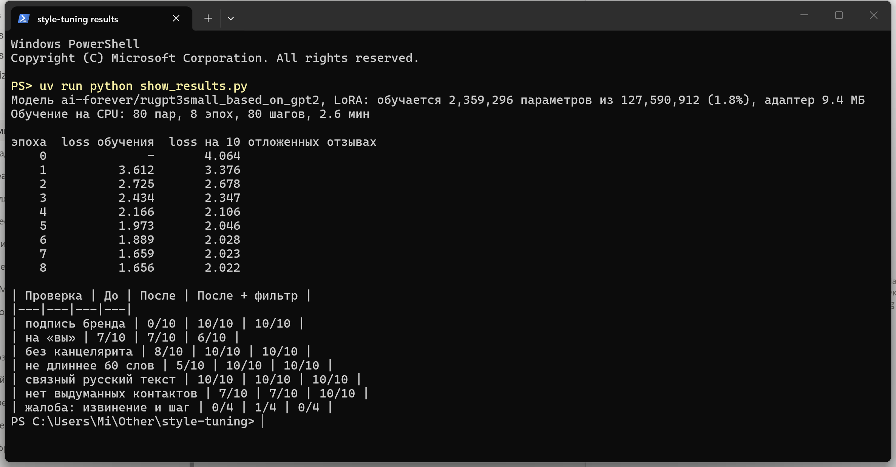
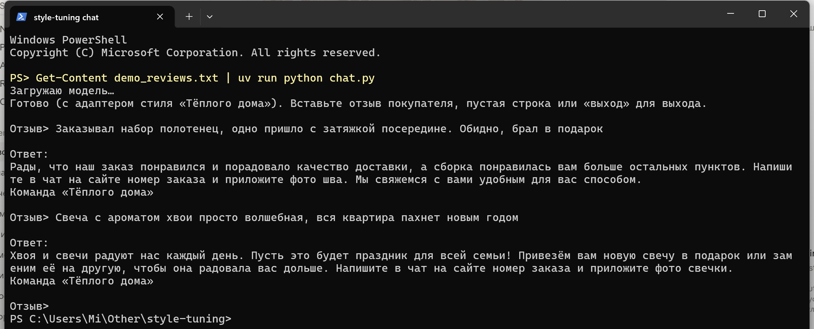

# Дообучение стиля: фирменные ответы магазина на отзывы

Небольшая русская модель учится отвечать на отзывы покупателей единым голосом бренда. Модель работает **локально, на обычном ноутбуке без видеокарты**: отзывы клиентов никуда не отправляются, за запросы не нужно платить.

Учебный проект. Магазин «Тёплый дом», отзывы и ответы вымышлены.

## Зачем это бизнесу

Когда на отзывы отвечают пять сотрудников, получается пять разных тонов: где-то «Уважаемый клиент, приносим извинения за доставленные неудобства», где-то сухое «Обратитесь в поддержку». Дообученная модель сразу пишет черновик в одном стиле:
- первая фраза про суть отзыва;
- обращение на «вы», без канцелярита;
- при жалобе короткое извинение и один конкретный следующий шаг;
- 2–4 предложения;
- подпись «Команда «Тёплого дома»».

Сотрудник проверяет черновик и отправляет.

## Результат

Обучение на процессоре ноутбука (Intel Core Ultra 5, без видеокарты):
- 2,6 минуты;
- 80 пар, 8 эпох;
- обучалось 2,4 млн параметров из 127 млн (1,8%);
- адаптер весит 9,4 МБ.

Ошибка (loss) на 10 отзывах, которых модель не видела, снизилась с **4,06 до 2,02** и к 8-й эпохе вышла на плато, без переобучения. Лог по шагам: `out/train_log.jsonl`.

Сравнение «до и после» на тех же 10 новых отзывах. Проверки считает код:

| Проверка | До | После | После + фильтр контактов |
|---|---|---|---|
| подпись бренда | 0/10 | **10/10** | 10/10 |
| без канцелярита | 8/10 | **10/10** | 10/10 |
| не длиннее 60 слов | 5/10 | **10/10** | 10/10 |
| на «вы» | 7/10 | 7/10 | 6/10 |
| связный русский текст | 10/10 | 10/10 | 10/10 |
| нет выдуманных телефонов и почты | 7/10 | 7/10 | **10/10** |
| жалоба: извинение и конкретный шаг | 0/4 | 1/4 | 0/4 |



**Что получилось.**
- До обучения модель писала как случайный форумный пост: «Дайте посмотреть на товар», «Данное предложение не является публичной офертой».
- После обучения все ответы короткие, с фирменной подписью, без канцелярита.
- Модель выучила ход ответа: реакция на отзыв, затем «Напишите в чат на сайте номер заказа и приложите фото».

**Чего не получилось, и это главный вывод.** Модель на 125 млн параметров выучила форму, а не понимание:
- на жалобу про полотенце с затяжкой она может ответить «Рады, что заказ понравился»;
- в 3 ответах из 10 выдумала телефоны и почту, хотя в датасете контактов нет. Это память исходного обучения.

Поэтому в `chat.py` стоит фильтр `drop_contacts`, который убирает такие предложения. В таблице он показан отдельной колонкой, чтобы не выдавать его за заслугу обучения.



Все 10 ответов «до» и «после» рядом с эталонами лежат в [`out/eval_report.md`](out/eval_report.md).

## Как сделано

| Шаг | Что | Файл |
|---|---|---|
| Данные | 90 пар «отзыв → ответ в фирменном стиле»: 80 для обучения, 10 отложены для проверки. Жалобы, благодарности, вопросы, смешанные отзывы. | `data/train.json`, `data/test.json` |
| Модель | `ai-forever/rugpt3small_based_on_gpt2`, 125 млн параметров (бывшая sberbank-ai/rugpt3small). Модель обучалась на русском, поэтому генерирует связный текст. | `common.py` |
| Дообучение | LoRA: r=16, alpha=32, dropout 0,05, слои `c_attn`, `c_proj`, `c_fc`. Учатся только адаптеры, базовая модель заморожена. | `train.py` |
| Лог обучения | loss на каждом шаге и loss на отложенных отзывах после каждой эпохи | `out/train_log.jsonl` |
| Проверка | одни и те же 10 новых отзывов, модель без адаптера и с ним, проверки стиля считает код | `evaluate.py`, `out/eval_report.md` |
| Чат | консольный чат с дообученной моделью, флаг `--base` для сравнения | `chat.py` |

Отличия от кода урока, которые повлияли на результат:
- **Loss только по ответу.** Текст отзыва в промпте замаскирован (`-100`): модель учится отвечать, а не пересказывать отзывы.
- **Нормальный разогрев.** В уроке `warmup_steps=100`, а всё обучение длится около 17 шагов. Скорость обучения не успевает вырасти, и модель почти не учится. Здесь разогрев составляет 10% шагов, дальше косинусное снижение.

## Запуск

```bash
uv sync
```

```bash
uv run python train.py
```

Обучение: скачивает модель (около 550 МБ) в `models/` и сохраняет адаптер в `out/adapter/`.

```bash
uv run python evaluate.py
```

Сравнение «до и после» пишется в `out/eval_report.md`.

```bash
uv run python chat.py
```

Консольный чат с дообученной моделью.

## Ограничения, честно

- Модель маленькая и старая (GPT-2). **Стиль** она усваивает хорошо, а **факты** путает: может пообещать замену, когда нужен возврат, или назвать срок, которого нет в правилах магазина. Поэтому это инструмент для черновиков, а не для автоответа.
- В датасете есть вымышленные правила магазина (14 дней на возврат и подобное). Модель может воспроизводить их как факты.
- Для продакшена логичнее та же схема на модели покрупнее, например Qwen2.5-7B через QLoRA на одной видеокарте. Или стиль через промпт и примеры в большой модели, если данные можно отправлять наружу.
